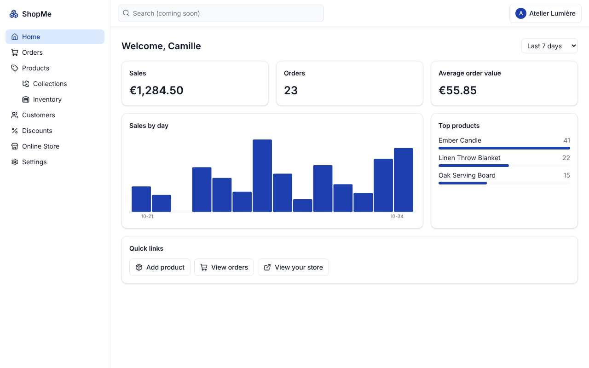
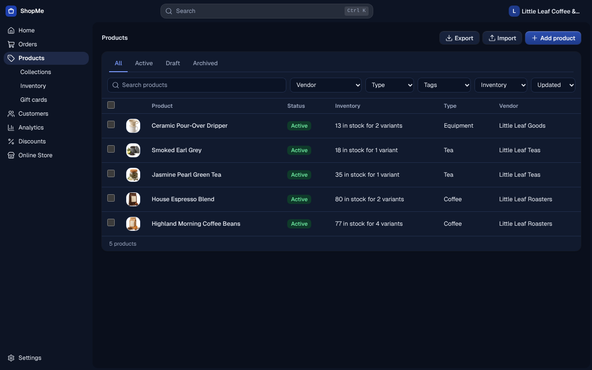
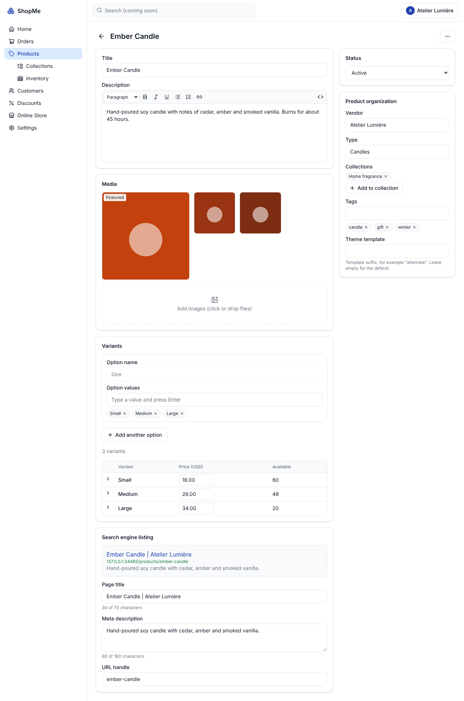
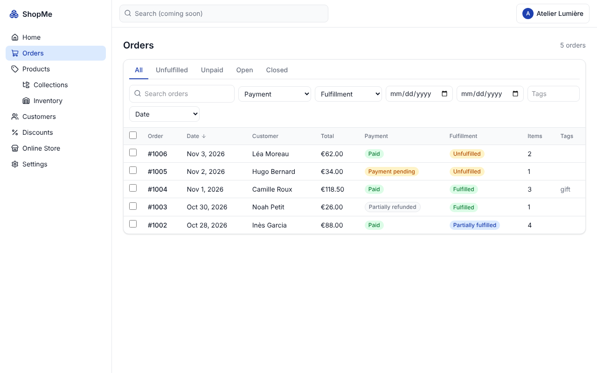
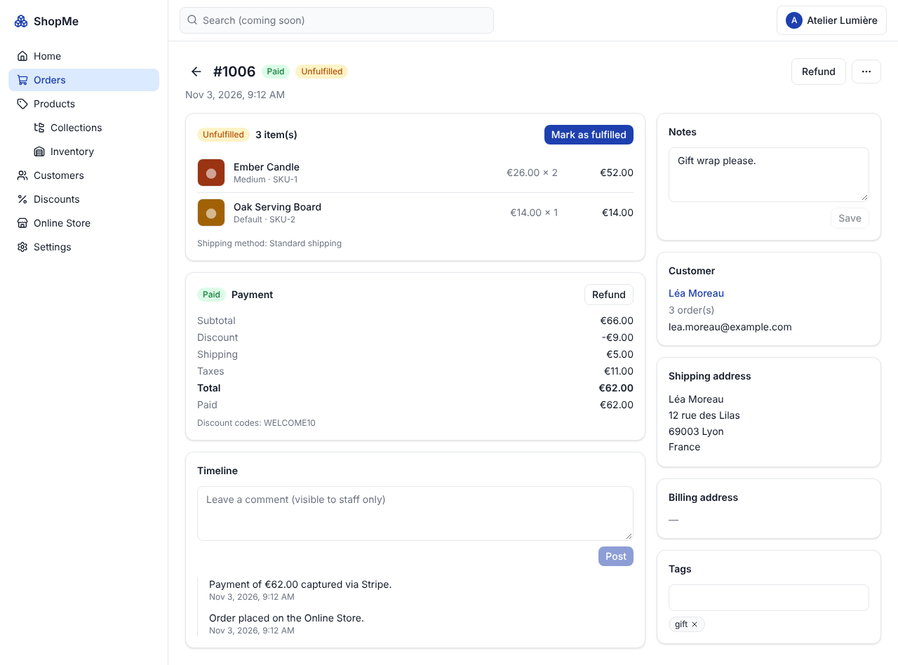
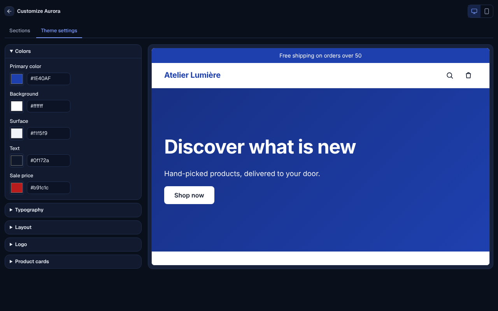
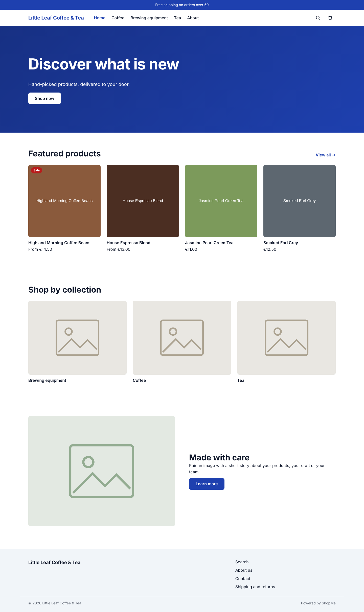

<div align="center">


# ShopMe

**La simplicité de Shopify, la liberté de l'open source.**

[](LICENSE)
[](https://github.com/aymaneprojects/shoppen/actions/workflows/ci.yml)


[English](README.md) · [Feuille de route](ROADMAP.md) · [Journal des modifications](CHANGELOG.md) · [Documentation](docs/README.md)

</div>

> **La v0.1.0 est une alpha précoce.** Elle sert à essayer le produit et à développer. Attendez-vous à des aspérités
> et à des changements incompatibles avant la 1.0, et ne l'exploitez pas comme boutique de production sans votre propre relecture.

## Qu'est-ce que ShopMe ?

ShopMe est une plateforme e-commerce auto-hébergeable, avec une boutique par installation. Elle exécute les thèmes
Liquid au format Shopify et implémente un sous-ensemble de l'API GraphQL Admin, de forme compatible avec Shopify.
Tout tourne dans un seul processus Node.js avec PostgreSQL, ou avec une base embarquée pour un usage local.

## Fonctionnalités de la v0.1

- **Installation :** un assistant de premier lancement crée la boutique et le compte propriétaire.
- **Catalogue :** produits, variantes et options, médias, collections (manuelles et à règles automatiques), stock (emplacement unique), métachamps.
- **Thèmes :** thèmes Liquid au format Shopify, le thème par défaut Aurora (MIT) et un éditeur des réglages de thème avec aperçu.
- **Vitrine :** routes produits, collections, recherche et pages, ainsi que l'API panier Ajax.
- **Paiement en tunnel :** commande en une seule page avec codes de réduction, zones et tarifs de livraison, et taux de taxes.
- **Moyens de paiement :** Stripe (les données de carte sont traitées par Stripe.js ; le serveur vérifie les webhooks signés), virement bancaire et paiement à la livraison.
- **Commandes :** listes et fiches, expéditions avec suivi, remboursements, annulation, réapprovisionnement et historique de la commande.
- **Clients et réductions :** fiches clients, codes de réduction.
- **Contenu de la boutique en ligne :** pages, menus.
- **Admin :** tableau de bord, interface en anglais et en français.
- **API :** sous-ensemble de l'API GraphQL Admin de forme Shopify, documenté dans [docs/spec](docs/spec/README.md).
- **Déploiement :** mode local sans configuration avec PostgreSQL embarqué (PGlite), et Docker Compose avec PostgreSQL 17.

**Absent de la v0.1 :** l'API GraphQL Storefront, les webhooks sortants, les applications OAuth, la multi-devise, la
vitrine multilingue, les cartes cadeaux, les retours, et le stock multi-emplacements.
La CLI, le SDK client et l'outil de migration sont des espaces réservés. Voir la [feuille de route](ROADMAP.md).

## Captures d'écran

<table>
  <tr>
    <td width="50%"><br><sub>Tableau de bord</sub></td>
    <td width="50%"><br><sub>Produits</sub></td>
  </tr>
  <tr>
    <td width="50%"><br><sub>Éditeur de produit</sub></td>
    <td width="50%"><br><sub>Commandes</sub></td>
  </tr>
  <tr>
    <td width="50%"><br><sub>Détail de commande</sub></td>
    <td width="50%"><br><sub>Éditeur de thème</sub></td>
  </tr>
  <tr>
    <td width="50%"><br><sub>Vitrine</sub></td>
    <td width="50%"><br><sub>Tunnel de commande</sub></td>
  </tr>
</table>

## Démarrage rapide

### En local (Node.js 22 et pnpm 9)

```bash
corepack enable
pnpm install
pnpm dev
```

Ouvrez <http://localhost:3000/admin> et suivez l'assistant de configuration. Aucune base à installer : les données sont
stockées dans `./data`, dans un PostgreSQL embarqué (PGlite). Données de démonstration (facultatif) : arrêtez le serveur,
lancez `pnpm seed`, puis redémarrez-le.

### Docker

```bash
docker compose up -d --build
```

Ouvrez <http://localhost:3000/admin>. Compose démarre ShopMe et PostgreSQL 17. Les réglages se placent dans un fichier
`.env` (voir [`.env.example`](.env.example)).

### Applications de bureau

Les applications Windows (`.exe`), macOS (`.dmg`) et Linux (`.AppImage`) (bêta) sont fabriquées automatiquement à chaque
version et publiées dans les [Releases GitHub](https://github.com/aymaneprojects/shoppen/releases) : un double-clic, et votre
boutique tourne sur votre ordinateur. Elles ne sont pas encore signées (un avertissement de sécurité s'affiche au premier
lancement). Voir [docs/install/desktop.fr.md](docs/install/desktop.fr.md).

## Déploiement sur votre serveur

[docs/install](docs/install/README.fr.md) couvre Docker Compose sur un VPS avec HTTPS via Caddy, les sauvegardes, les
restaurations et les mises à jour.

## Architecture

- **Un seul processus :** un serveur Fastify (`apps/server`) sert l'API GraphQL Admin, la SPA admin, la vitrine, le panier, le paiement et les webhooks.
- **Base de données :** PostgreSQL via Drizzle ORM. Sans `DATABASE_URL`, la base PGlite embarquée est utilisée.
- **API :** GraphQL Yoga avec Pothos pour le schéma.
- **Admin :** application monopage React et Vite, compilée et servie par le serveur sur `/admin`.
- **Moteur de thèmes :** moteur basé sur LiquidJS pour les thèmes au format Shopify.
- **Tâches de fond :** file d'attente dans le processus, Redis n'est donc pas nécessaire.
- **Locataires :** une boutique par installation. Les tables gardent un `shop_id` pour qu'une offre hébergée multi-boutiques reste possible plus tard.

## Compatibilité avec Shopify

ShopMe est développé **en clean-room** : il reproduit ce que font les interfaces, avec son propre code et ses propres
spécifications. Les spécifications de [docs/spec](docs/spec/README.md) sont rédigées avec nos mots, à partir de la
documentation publique et de notre propre boutique de développement. Aucun code, fichier de thème ni texte de documentation
de Shopify n'est copié. Voir la [politique clean-room](docs/legal/clean-room.md).

- **Thèmes :** le moteur Liquid et le format de thème suivent la mise en page Shopify Online Store 2.0. Le thème par défaut Aurora est fourni avec ShopMe. La couverture des thèmes tiers n'est pas encore vérifiée.
- **API GraphQL Admin :** un sous-ensemble aux types, champs et `userErrors` de forme Shopify. Il n'est pas complet.
- **API panier Ajax :** implémentée.
- **API GraphQL Storefront :** pas encore implémentée.

## Feuille de route

Voir [ROADMAP.md](ROADMAP.md). Les phases sont des objectifs, pas des promesses.

## Contribuer

Lisez d'abord [CONTRIBUTING.md](CONTRIBUTING.md) et la [politique clean-room](docs/legal/clean-room.md). Ne collez jamais
de code tiers, de fichiers de thème, de vidages de schéma ni de texte de documentation dans les tickets ou les pull requests.

## Licence

- Le cœur est sous licence **AGPL-3.0** ([LICENSE](LICENSE)).
- `packages/theme-default`, `packages/sdk` et `packages/ui` sont sous licence **MIT** (chacun a son propre `LICENSE`).

## Avertissement

ShopMe est un projet indépendant, non affilié à Shopify Inc., et non approuvé ni sponsorisé par elle. Shopify est une marque
de Shopify Inc.
