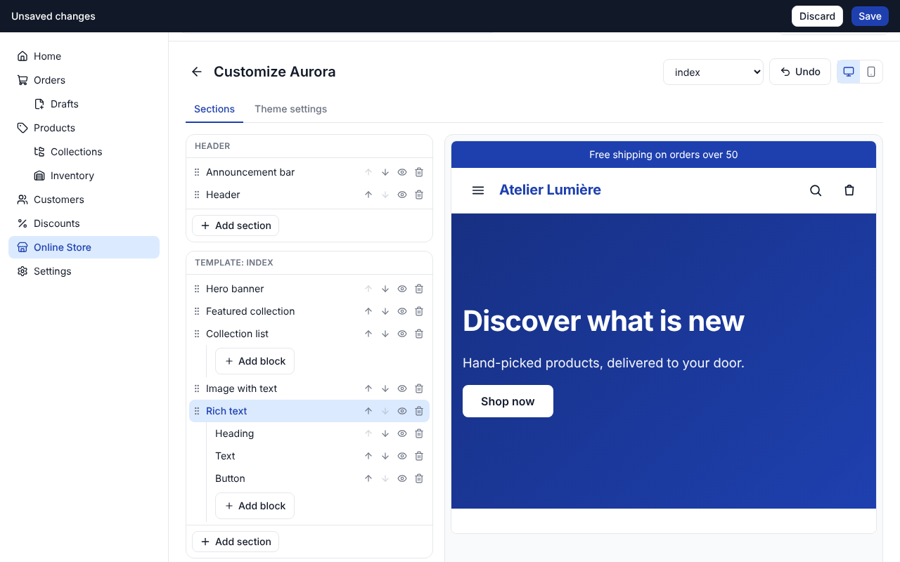
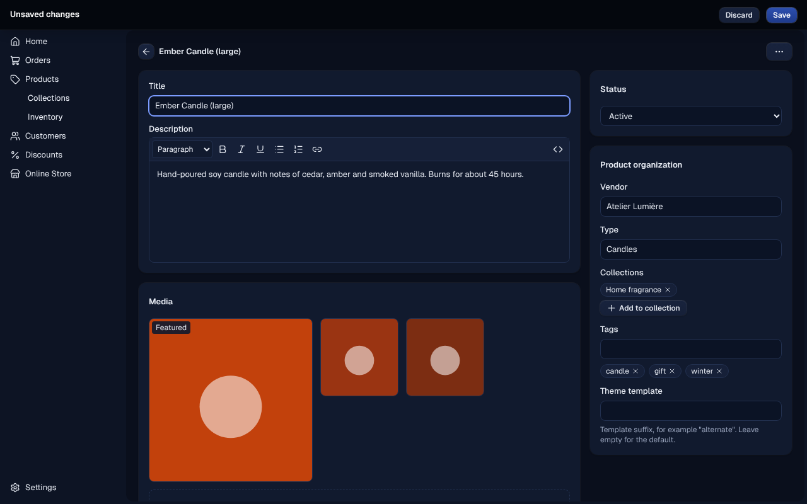
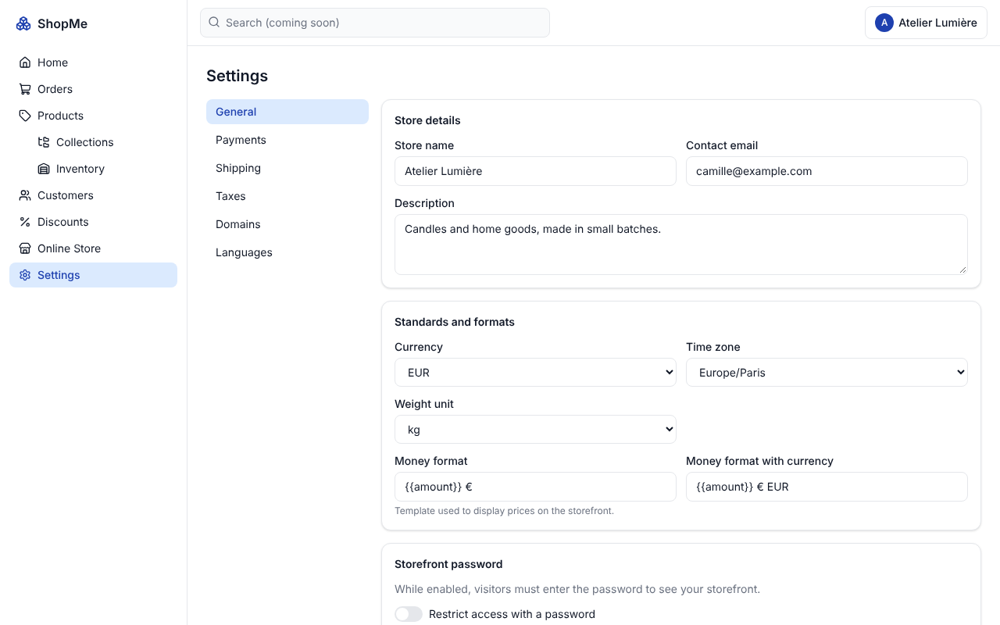
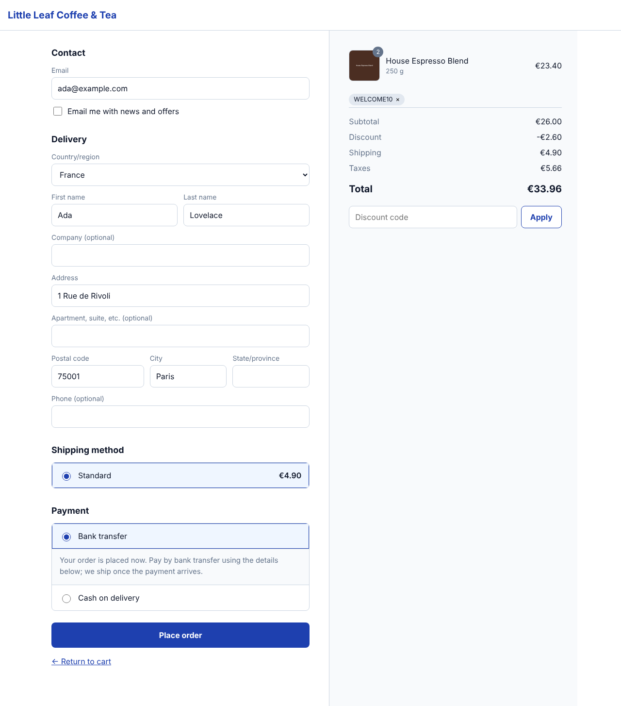
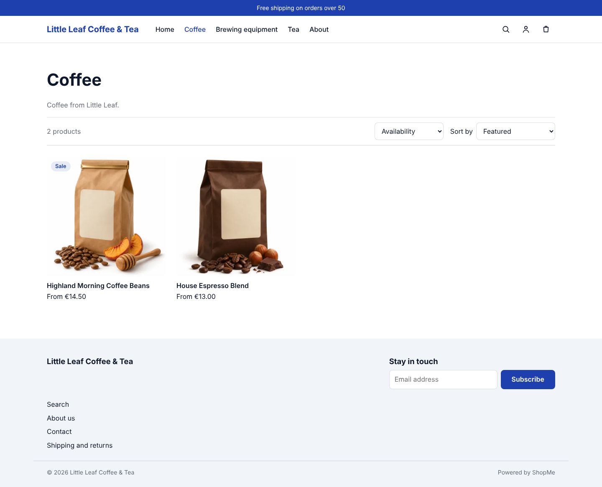

<div align="center">


# ShopMe

**Votre boutique en ligne, sur votre ordinateur ou votre serveur. Open source.**

[](LICENSE)
[](https://github.com/aymaneprojects/shopme/actions/workflows/ci.yml)


[English](README.md) · [Feuille de route](ROADMAP.md) · [Journal des modifications](CHANGELOG.md) · [Documentation](docs/README.md)

</div>

> **La v0.1.0 est une alpha précoce.** Elle sert à essayer le produit et à développer. Attendez-vous à des aspérités
> et à des changements incompatibles avant la 1.0, et ne l'exploitez pas comme boutique de production sans votre propre relecture.

## Qu'est-ce que ShopMe ?

ShopMe est une plateforme e-commerce auto-hébergeable, avec une boutique par installation. Elle exécute les thèmes
Liquid au format Shopify et implémente un sous-ensemble de l'API GraphQL Admin, de forme compatible avec Shopify.
Tout tourne dans un seul processus Node.js avec PostgreSQL, ou avec une base embarquée pour un usage local.

## Fonctionnalités de la v0.1

- **Catalogue :** produits, variantes et options, médias, collections (manuelles et à règles automatiques), stock sur plusieurs emplacements, types de produits, fournisseurs et étiquettes, métachamps avec leurs définitions, éditeur en masse, et import et export CSV.
- **Boutique en ligne et thèmes :** thèmes Liquid (mise en page Online Store 2.0), thème par défaut Aurora (MIT), envoi et bibliothèque de thèmes, éditeur de sections avec aperçu, pages, menus, blogs et articles, redirections d'URL, formulaires de contact et d'inscription à la newsletter, et comptes clients (inscription, connexion, réinitialisation du mot de passe, historique des commandes, carnet d'adresses).
- **Recherche et langues :** recherche de la vitrine avec classement, tolérance aux fautes de frappe et recherche prédictive ; langues et traductions avec des URL en `/fr`.
- **Paiement en tunnel et moyens de paiement :** commande en une seule page, Stripe (les données de carte sont traitées par Stripe.js ; le serveur vérifie les webhooks signés), virement bancaire, paiement à la livraison, zones et tarifs de livraison, taux de taxes, et cartes cadeaux comme moyen de paiement.
- **Commandes et clients :** liste et fiche de commande avec historique, expéditions avec suivi, remboursements, annulation, modification de commande, retours, commandes brouillons avec lien de facture, relance des paniers abandonnés, fiches clients, et export des données d'un client.
- **Marketing et réductions :** codes de réduction, réductions au niveau du panier, réductions automatiques, achetez X, obtenez Y, livraison offerte, cartes cadeaux (émission, solde, utilisation, envoi par courriel), et courriels de relance de paniers abandonnés.
- **Abonnements :** options d'achat sur les produits (livraison tous les N jours, semaines ou mois, avec une réduction), contrats d'abonnement créés au paiement, renouvellements facturés automatiquement (carte Stripe enregistrée débitée hors session, ou commande en attente de paiement pour le virement et le paiement à la livraison) avec nouvelles tentatives, pause, saut d'une livraison, reprise et résiliation depuis l'administration et le compte client, courriels d'abonnement, et réductions réservées aux achats uniques, aux abonnements ou aux N premiers paiements.
- **Contenu :** pages, menus, blogs et articles, et politiques (remboursement, confidentialité, conditions, livraison) avec une bannière de cookies.
- **Analyses :** 12 rapports avec une période, une période de comparaison et export CSV, et suivi des visites propre à la boutique qui respecte la bannière de cookies et le signal Ne pas suivre.
- **Plateforme et sécurité :** un assistant de premier lancement, des rôles et permissions pour l'équipe avec invitations, la double authentification (TOTP et codes de récupération), la liste des sessions actives, un éditeur des modèles de notifications (anglais et français), des webhooks sortants signés (HMAC-SHA256, avec nouvelles tentatives), des en-têtes de sécurité, la mise en cache par ETag, le redimensionnement des images (y compris WebP et AVIF), l'export et l'import de boutique, et des sauvegardes planifiées.
- **Administration :** interface en anglais et en français, thème bleu nuit sombre avec bascule clair et sombre, police Geist, et palette de commandes Ctrl/⌘+K.
- **Migration et données :** un importateur de migration depuis Shopify (ligne de commande et page d'administration, via l'API Admin), import et export CSV, et archives de boutique `.shopme` pour déplacer une boutique complète.
- **API :** API GraphQL Admin (sous-ensemble compatible), documentée dans [docs/spec](docs/spec/README.md).
- **Déploiement :** mode local sans configuration avec PostgreSQL embarqué (PGlite), Docker Compose avec PostgreSQL 17, et applications de bureau (bêta).

**Absent de la v0.1 :** l'API GraphQL Storefront, les applications OAuth et une plateforme d'applications, la multi-devise et
les marchés, la TVA de l'UE et le guichet OSS, les étiquettes d'expédition et les tarifs des transporteurs (y compris les
transporteurs français), le retrait en point relais, les opérations en masse, une API REST Admin, les échanges, les segments
de clients, les métaobjets, le point de vente, les transferts de stock, les bons de commande et la génération en masse de codes
de réduction. La CLI et le SDK client sont des espaces réservés. Voir la [feuille de route](ROADMAP.md).

## Captures d'écran

<table>
  <tr>
    <td width="50%"><br><sub>Tableau de bord</sub></td>
    <td width="50%"><br><sub>Produits</sub></td>
  </tr>
  <tr>
    <td width="50%"><br><sub>Éditeur de produit</sub></td>
    <td width="50%"><br><sub>Commandes</sub></td>
  </tr>
  <tr>
    <td width="50%"><br><sub>Détail de commande</sub></td>
    <td width="50%"><br><sub>Éditeur de thème</sub></td>
  </tr>
  <tr>
    <td width="50%"><br><sub>Éditeur de sections</sub></td>
    <td width="50%"><br><sub>Bibliothèque de thèmes</sub></td>
  </tr>
  <tr>
    <td width="50%"><br><sub>Palette de commandes</sub></td>
    <td width="50%"><br><sub>Barre d'enregistrement</sub></td>
  </tr>
  <tr>
    <td width="50%"><br><sub>Éditeur de produit, thème clair</sub></td>
    <td width="50%"><br><sub>Réglages</sub></td>
  </tr>
  <tr>
    <td width="50%"><br><sub>Vitrine</sub></td>
    <td width="50%"><br><sub>Tunnel de commande</sub></td>
  </tr>
  <tr>
    <td width="50%"><br><sub>Page produit</sub></td>
    <td width="50%"><br><sub>Page collection</sub></td>
  </tr>
</table>

## Démarrage rapide

### En local (Node.js 22 et pnpm 9)

```bash
corepack enable
pnpm install
pnpm dev
```

Ouvrez <http://localhost:3000/admin> et suivez l'assistant de configuration. Aucune base à installer : les données sont
stockées dans `./data`, dans un PostgreSQL embarqué (PGlite). Données de démonstration (facultatif) : arrêtez le serveur,
lancez `pnpm seed`, puis redémarrez-le.

### Docker

```bash
docker compose up -d --build
```

Ouvrez <http://localhost:3000/admin>. Compose démarre ShopMe et PostgreSQL 17. Les réglages se placent dans un fichier
`.env` (voir [`.env.example`](.env.example)).

### Applications de bureau

Les applications Windows (`.exe`), macOS (`.dmg`) et Linux (`.AppImage`) (bêta) sont fabriquées automatiquement à chaque
version et publiées dans les [Releases GitHub](https://github.com/aymaneprojects/shopme/releases) : un double-clic, et votre
boutique tourne sur votre ordinateur. Elles ne sont pas encore signées (un avertissement de sécurité s'affiche au premier
lancement). Voir [docs/install/desktop.fr.md](docs/install/desktop.fr.md).

## Déploiement sur votre serveur

[docs/install](docs/install/README.fr.md) couvre Docker Compose sur un VPS avec HTTPS via Caddy, les sauvegardes, les
restaurations et les mises à jour.

## Architecture

- **Un seul processus :** un serveur Fastify (`apps/server`) sert l'API GraphQL Admin, la SPA admin, la vitrine, le panier, le paiement et les webhooks.
- **Base de données :** PostgreSQL via Drizzle ORM. Sans `DATABASE_URL`, la base PGlite embarquée est utilisée.
- **API :** GraphQL Yoga avec Pothos pour le schéma.
- **Admin :** application monopage React et Vite, compilée et servie par le serveur sur `/admin`.
- **Moteur de thèmes :** moteur de thèmes basé sur LiquidJS.
- **Tâches de fond :** file d'attente dans le processus, Redis n'est donc pas nécessaire.
- **Locataires :** une boutique par installation. Les tables gardent un `shop_id` pour qu'une offre hébergée multi-boutiques reste possible plus tard.

## Compatibilité

ShopMe est écrit de zéro, avec son propre code et ses propres spécifications (voir la [politique clean-room](docs/legal/clean-room.md)).
Pour l'interopérabilité, il lit les thèmes au format Shopify et expose un sous-ensemble compatible de l'API Admin de Shopify.

- **Thèmes :** thèmes Liquid avec la mise en page Online Store 2.0. Le thème par défaut Aurora est fourni avec ShopMe. La couverture des thèmes tiers n'est pas encore vérifiée.
- **API GraphQL Admin :** un sous-ensemble compatible de types, champs et `userErrors`. Il n'est pas complet.
- **API panier Ajax :** implémentée.
- **API GraphQL Storefront :** pas encore implémentée.
- **Couverture :** [docs/spec/coverage-report.md](docs/spec/coverage-report.md) liste ce qui est fait et ce qui manque encore.

## Feuille de route

Voir [ROADMAP.md](ROADMAP.md). Les phases sont des objectifs, pas des promesses.

## Contribuer

Lisez d'abord [CONTRIBUTING.md](CONTRIBUTING.md) et la [politique clean-room](docs/legal/clean-room.md). Ne collez jamais
de code tiers, de fichiers de thème, de vidages de schéma ni de texte de documentation dans les tickets ou les pull requests.

## Licence

- Le cœur est sous licence **AGPL-3.0** ([LICENSE](LICENSE)).
- `packages/theme-default`, `packages/sdk` et `packages/ui` sont sous licence **MIT** (chacun a son propre `LICENSE`).
- Données incluses : les contours des pays de la carte de la vue en direct viennent du paquet `world-atlas` (licence ISC, copyright Michael Bostock),
  dérivé de Natural Earth (domaine public), et sont lus avec `topojson-client` (licence ISC). La table fuseau horaire vers pays
  (`packages/core/src/services/analytics/tz-countries.ts`, produite par `scripts/gen-tz-countries.mjs`) est dérivée de la base de fuseaux horaires
  IANA (domaine public).

## Avertissement

ShopMe est un projet indépendant, non affilié à Shopify Inc., et non approuvé ni sponsorisé par elle. Shopify est une marque
de Shopify Inc.
