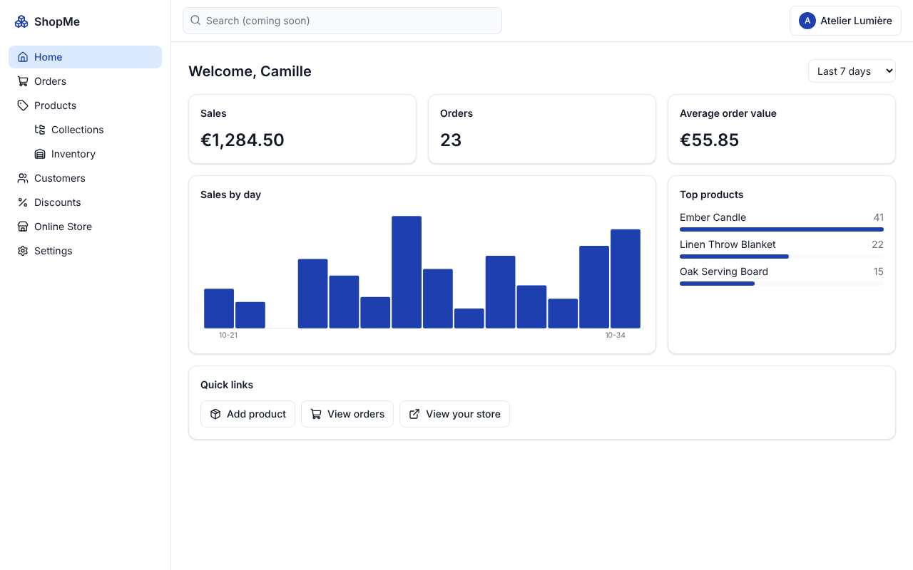
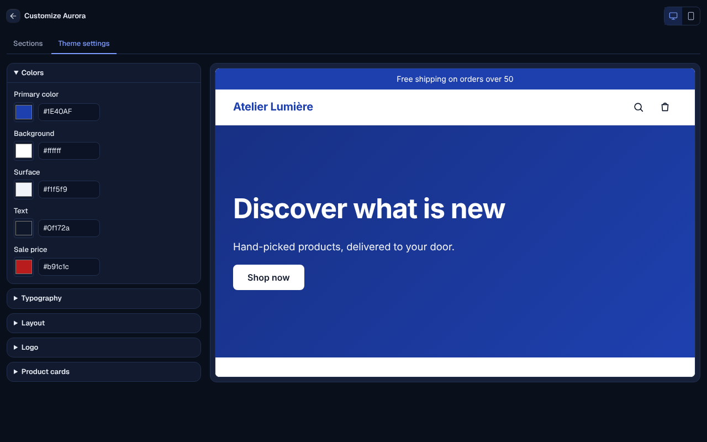
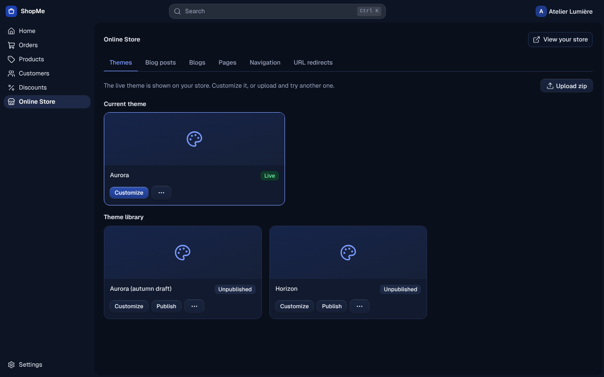
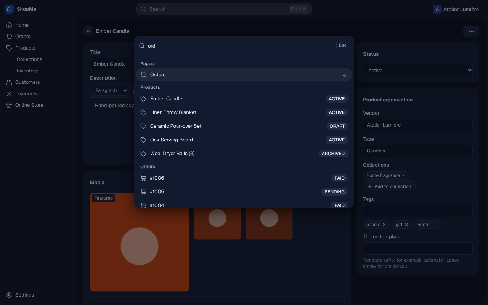
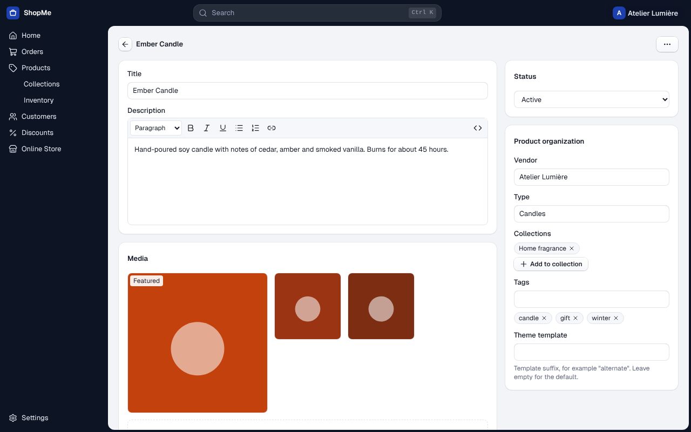
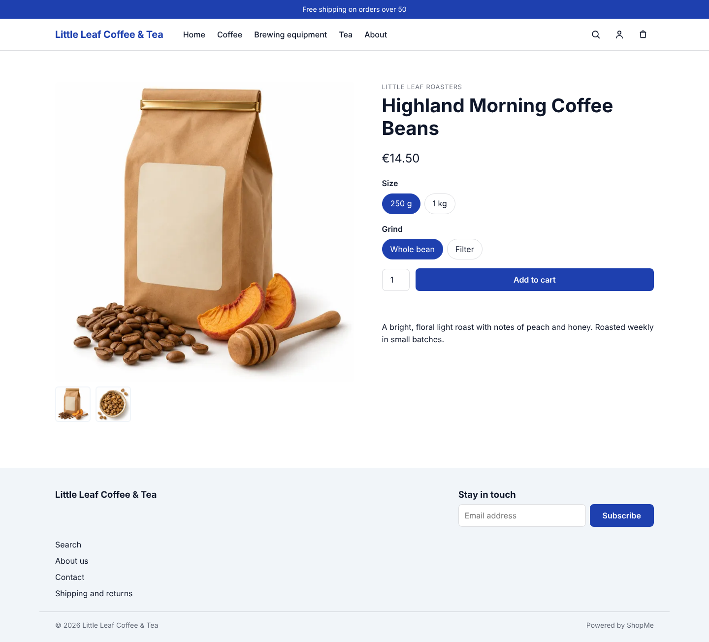

<div align="center">


# ShopMe

**Your online store, on your computer or your own server. Open source.**

[](LICENSE)
[](https://github.com/aymaneprojects/shopme/actions/workflows/ci.yml)


[Français](README.fr.md) · [Roadmap](ROADMAP.md) · [Changelog](CHANGELOG.md) · [Documentation](docs/README.md)

</div>

> **v0.1.0 is an early alpha.** It is usable for trying things out and for development. Expect rough edges and breaking
> changes before 1.0, and do not run it as a production store without your own review.

## What is ShopMe

ShopMe is a self-hostable e-commerce platform for one shop per installation. It runs Shopify-format Liquid themes and
implements a compatible subset of the Shopify Admin GraphQL API. Everything runs in one Node.js process with PostgreSQL,
or with an embedded database for local use.

## Features in v0.1

- **Catalog:** products, variants and options, media, collections (manual and smart rules), inventory across multiple locations, product types, vendors and tags, metafields with definitions, a bulk editor, and CSV import and export.
- **Online store and themes:** Liquid themes (Online Store 2.0 layout), the Aurora default theme (MIT), theme upload and library, a section-level theme editor with preview, pages, menus, blogs and articles, URL redirects, contact and newsletter forms, and customer accounts (registration, login, password reset, order history, address book).
- **Search and languages:** storefront search with ranking, typo tolerance, and predictive search; languages and translations with `/fr` URLs.
- **Checkout and payments:** one-page checkout, Stripe (card data is handled by Stripe.js; the server verifies signed webhooks), bank transfer, cash on delivery, shipping zones and rates, tax rates, and gift cards as a payment method.
- **Orders and customers:** order list and detail with timeline, fulfillments with tracking, refunds, cancellation, order editing, returns, draft orders with an invoice link, abandoned checkout recovery, customer records, and per-customer data export.
- **Marketing and discounts:** discount codes, cart-level discounts, automatic discounts, buy X get Y, free shipping, gift cards (issue, balance, redemption, email), and abandoned checkout recovery emails.
- **Subscriptions:** purchase options on products (deliver every N days, weeks or months, with a discount), subscription contracts created at checkout, renewals billed automatically (saved Stripe card charged off-session, or a pending order for bank transfer and cash on delivery) with retries, pause, skip, resume and cancel from the admin and the customer account, subscription emails, and discounts limited to one-time purchases, subscriptions or the first N payments.
- **Content:** pages, menus, blogs and articles, and policies (refund, privacy, terms, shipping) with a cookie banner.
- **Analytics:** 12 reports with a date range, a comparison period and CSV export, and first-party visit tracking that respects the cookie banner and Do Not Track.
- **Platform and security:** a first-run setup wizard, staff roles and permissions with invitations, two-factor authentication (TOTP and recovery codes), active sessions, editable notification templates (English and French), signed outbound webhooks (HMAC-SHA256, with retries), security headers, ETag caching, image resizing (including WebP and AVIF), store export and import, and scheduled backups.
- **Admin:** English and French interface, a dark navy theme with a light and dark switch, the Geist font, and a Ctrl/⌘+K command palette.
- **Migration and data:** a Shopify migration importer (command line and admin page, through the Admin API), CSV import and export, and `.shopme` store archives for moving a whole store.
- **API:** Admin GraphQL API (compatible subset), documented in [docs/spec](docs/spec/README.md).
- **Deployment:** zero-setup local mode with embedded PostgreSQL (PGlite), Docker Compose with PostgreSQL 17, and desktop apps (beta).

**Not in v0.1:** Storefront GraphQL API, OAuth apps and an app platform, multi-currency and markets, EU VAT and OSS, shipping
labels and carrier rates (including French carriers), local pickup, bulk operations, a REST Admin API, exchanges, customer
segments, metaobjects, point of sale, inventory transfers, purchase orders, and bulk discount code generation. The CLI and the
client SDK are placeholders. See the [ROADMAP](ROADMAP.md).

## Screenshots

<table>
  <tr>
    <td width="50%"><br><sub>Dashboard</sub></td>
    <td width="50%"><br><sub>Products</sub></td>
  </tr>
  <tr>
    <td width="50%"><br><sub>Product editor</sub></td>
    <td width="50%"><br><sub>Orders</sub></td>
  </tr>
  <tr>
    <td width="50%"><br><sub>Order detail</sub></td>
    <td width="50%"><br><sub>Theme editor</sub></td>
  </tr>
  <tr>
    <td width="50%"><br><sub>Section editor</sub></td>
    <td width="50%"><br><sub>Theme library</sub></td>
  </tr>
  <tr>
    <td width="50%"><br><sub>Command palette</sub></td>
    <td width="50%"><br><sub>Save bar</sub></td>
  </tr>
  <tr>
    <td width="50%"><br><sub>Product editor, light theme</sub></td>
    <td width="50%"><br><sub>Settings</sub></td>
  </tr>
  <tr>
    <td width="50%"><br><sub>Storefront</sub></td>
    <td width="50%"><br><sub>Checkout</sub></td>
  </tr>
  <tr>
    <td width="50%"><br><sub>Product page</sub></td>
    <td width="50%"><br><sub>Collection page</sub></td>
  </tr>
</table>

## Quick start

### Local (Node.js 22 and pnpm 9)

```bash
corepack enable
pnpm install
pnpm dev
```

Open <http://localhost:3000/admin> and complete the setup wizard. No database to install: data is stored under `./data`
in an embedded PostgreSQL (PGlite). Optional demo content: stop the server, run `pnpm seed`, start it again.

### Docker

```bash
docker compose up -d --build
```

Open <http://localhost:3000/admin>. Compose starts ShopMe and PostgreSQL 17. Settings go in a `.env` file (see [`.env.example`](.env.example)).

### Desktop apps

Windows (`.exe`), macOS (`.dmg`) and Linux (`.AppImage`) apps (beta) are built automatically for each release and attached to
[GitHub Releases](https://github.com/aymaneprojects/shopme/releases): double-click, and your store runs on your computer.
They are unsigned for now (expect a security prompt on first launch). See [docs/install/desktop.md](docs/install/desktop.md).

## Deploy on your server

[docs/install](docs/install/README.md) covers Docker Compose on a VPS with HTTPS through Caddy, backups, restores and upgrades.

## Architecture

- **One process:** a Fastify server (`apps/server`) serves the Admin GraphQL API, the admin SPA, the storefront, the cart, checkout and webhooks.
- **Database:** PostgreSQL through Drizzle ORM. Without `DATABASE_URL`, the embedded PGlite database is used.
- **API:** GraphQL Yoga with Pothos for the schema.
- **Admin:** React and Vite single-page app, built and served by the server at `/admin`.
- **Theme engine:** LiquidJS-based theme renderer.
- **Background jobs:** in-process queue, so Redis is not required.
- **Tenancy:** one shop per installation. Tables keep a `shop_id` so a hosted multi-shop offer stays possible later.

## Compatibility

ShopMe is written from scratch with its own code and specifications (see the [clean-room policy](docs/legal/clean-room.md)).
For interoperability it reads Shopify-format themes and exposes a compatible subset of the Shopify Admin API.

- **Themes:** Liquid themes in the Online Store 2.0 layout. The Aurora default theme ships with ShopMe. Coverage of third-party themes is not verified yet.
- **Admin GraphQL:** a compatible subset of types, fields and `userErrors`. It is not complete.
- **Ajax Cart API:** implemented.
- **Storefront GraphQL:** not implemented yet.
- **Coverage:** [docs/spec/coverage-report.md](docs/spec/coverage-report.md) lists what is implemented and what is still missing.

## Roadmap

See [ROADMAP.md](ROADMAP.md). Phases are goals, not promises.

## Contributing

Read [CONTRIBUTING.md](CONTRIBUTING.md) and the [clean-room policy](docs/legal/clean-room.md) first. Never paste
third-party code, theme files, schema dumps or documentation text into issues or pull requests.

## License

- The core is licensed under **AGPL-3.0** ([LICENSE](LICENSE)).
- `packages/theme-default`, `packages/sdk` and `packages/ui` are licensed under **MIT** (each has its own `LICENSE`).
- Bundled data: the country shapes of the analytics live view map come from the `world-atlas` package (ISC licence, copyright Michael Bostock),
  derived from Natural Earth (public domain), and are read with `topojson-client` (ISC licence). The time zone to country table
  (`packages/core/src/services/analytics/tz-countries.ts`, built by `scripts/gen-tz-countries.mjs`) is derived from the IANA time zone database
  (public domain).

## Disclaimer

ShopMe is an independent project, not affiliated with or endorsed by Shopify Inc. Shopify is a trademark of Shopify Inc.
