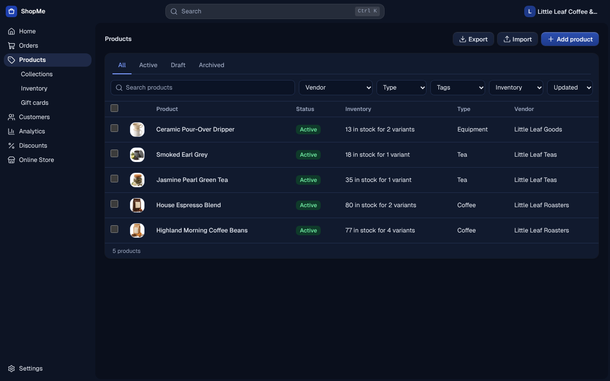
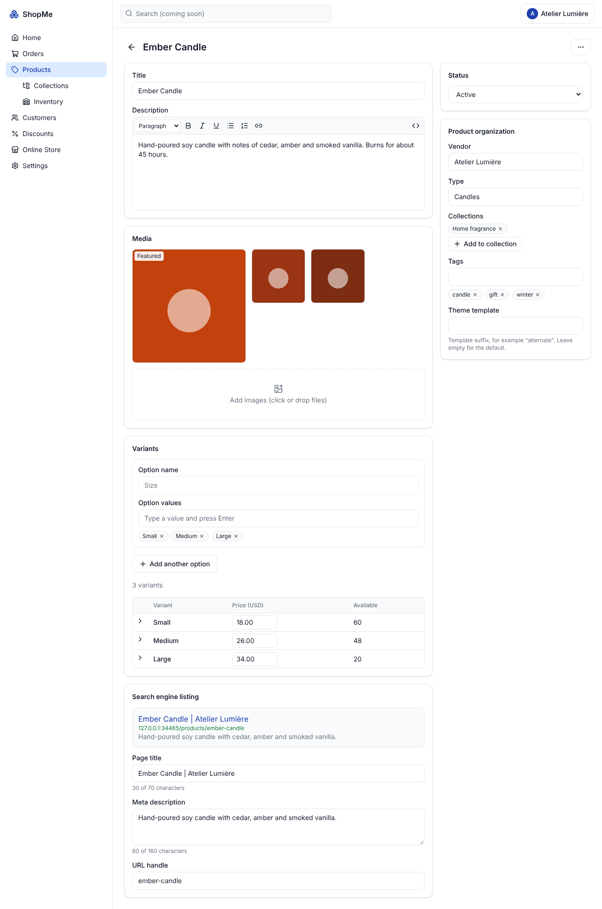
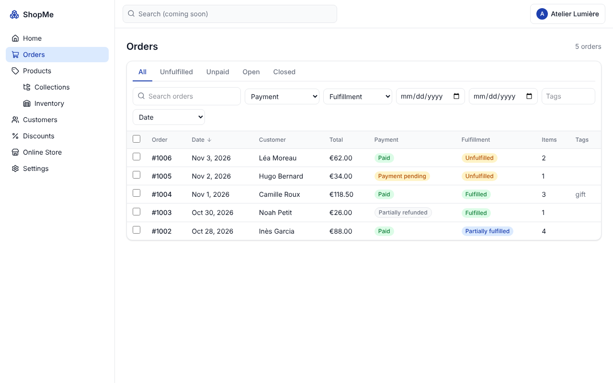
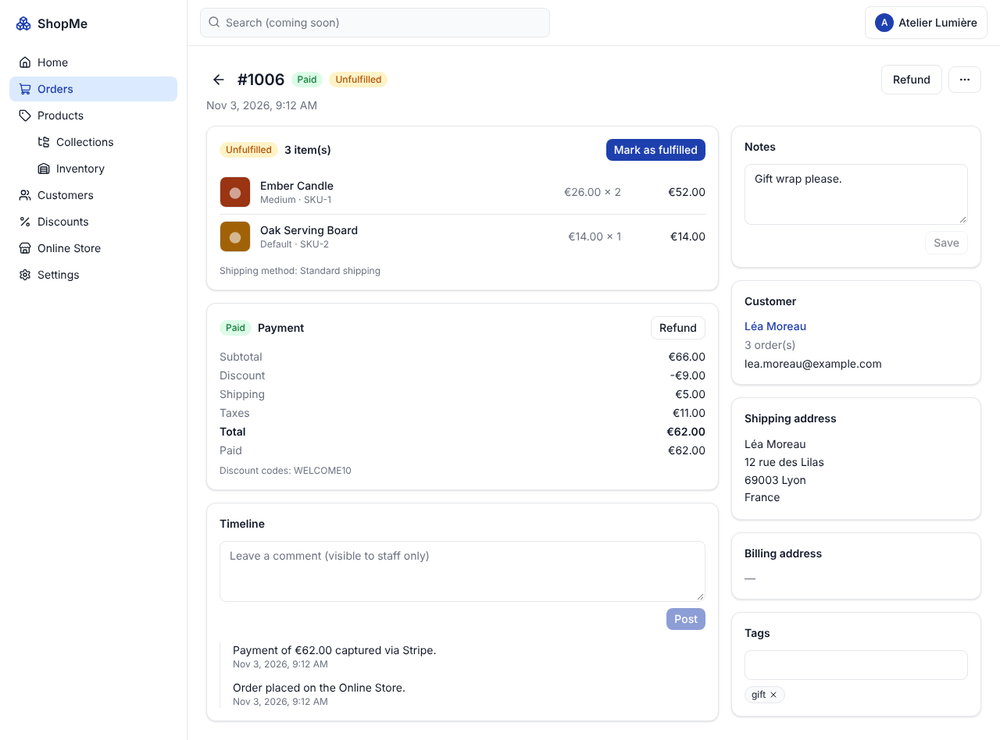
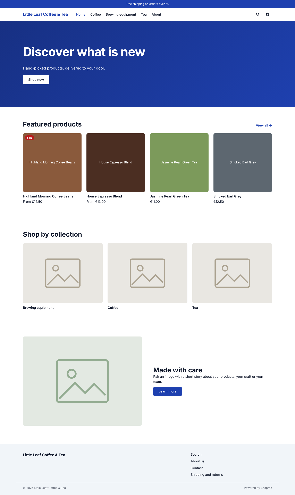
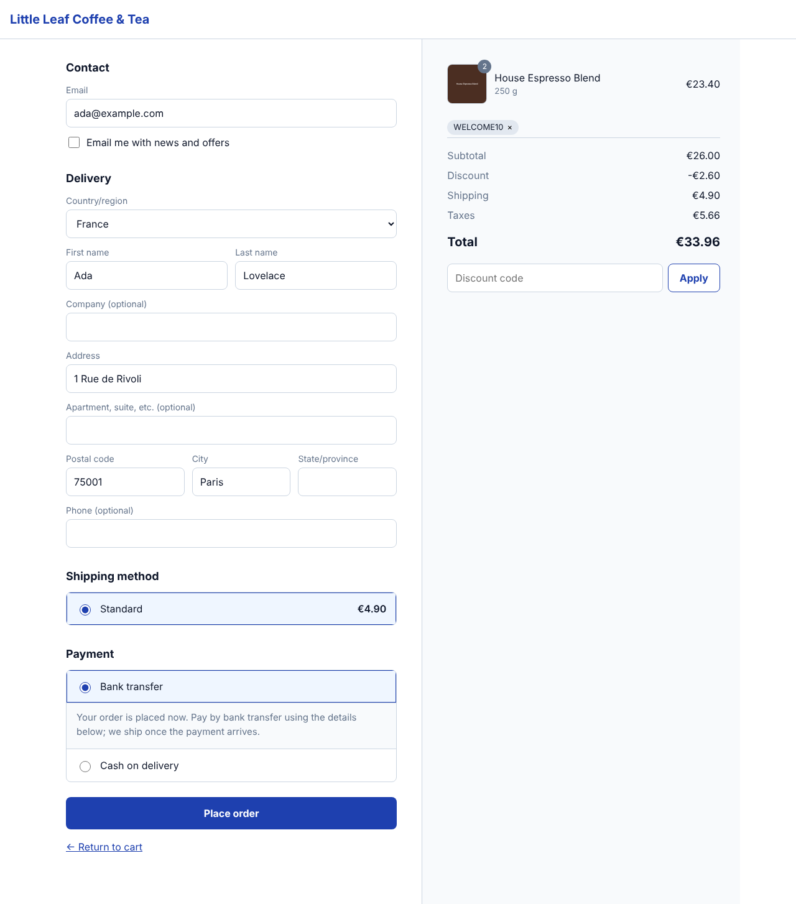

<div align="center">


# ShopMe

**The simplicity of Shopify, the freedom of open source.**

[](LICENSE)
[](https://github.com/aymaneprojects/shoppen/actions/workflows/ci.yml)


[Français](README.fr.md) · [Roadmap](ROADMAP.md) · [Changelog](CHANGELOG.md) · [Documentation](docs/README.md)

</div>

> **v0.1.0 is an early alpha.** It is usable for trying things out and for development. Expect rough edges and breaking
> changes before 1.0, and do not run it as a production store without your own review.

## What is ShopMe

ShopMe is a self-hostable e-commerce platform for one shop per installation. It runs Shopify-format Liquid themes and
implements a subset of the Shopify-shaped Admin GraphQL API. Everything runs in one Node.js process with PostgreSQL,
or with an embedded database for local use.

## Features in v0.1

- **Setup:** a first-run wizard creates the shop and the owner account.
- **Catalog:** products, variants and options, media, collections (manual and smart rules), inventory (single location), metafields.
- **Themes:** Shopify-format Liquid themes, the Aurora default theme (MIT), and a theme settings editor with preview.
- **Storefront:** product, collection, search and page routes, and the Ajax Cart API.
- **Checkout:** one-page checkout with discount codes, shipping zones and rates, and tax rates.
- **Payments:** Stripe (card data is handled by Stripe.js; the server verifies signed webhooks), bank transfer, and cash on delivery.
- **Orders:** list and detail views, fulfillments with tracking, refunds, cancellation, restock, and an order timeline.
- **Customers and discounts:** customer records, discount codes.
- **Online store content:** pages, menus.
- **Admin:** dashboard, English and French interface.
- **API:** Shopify-shaped Admin GraphQL subset, documented in [docs/spec](docs/spec/README.md).
- **Deployment:** zero-setup local mode with embedded PostgreSQL (PGlite), and Docker Compose with PostgreSQL 17.

**Not in v0.1:** Storefront GraphQL API, outbound webhooks, OAuth apps, multi-currency, multi-language storefront,
gift cards, returns, multi-location inventory, desktop apps. The CLI, client SDK and migration tool are placeholders.
See the [ROADMAP](ROADMAP.md).

## Screenshots

<table>
  <tr>
    <td width="50%"><br><sub>Dashboard</sub></td>
    <td width="50%"><br><sub>Products</sub></td>
  </tr>
  <tr>
    <td width="50%"><br><sub>Product editor</sub></td>
    <td width="50%"><br><sub>Orders</sub></td>
  </tr>
  <tr>
    <td width="50%"><br><sub>Order detail</sub></td>
    <td width="50%"><br><sub>Theme editor</sub></td>
  </tr>
  <tr>
    <td width="50%"><br><sub>Storefront</sub></td>
    <td width="50%"><br><sub>Checkout</sub></td>
  </tr>
</table>

## Quick start

### Local (Node.js 22 and pnpm 9)

```bash
corepack enable
pnpm install
pnpm dev
```

Open <http://localhost:3000/admin> and complete the setup wizard. No database to install: data is stored under `./data`
in an embedded PostgreSQL (PGlite). Optional demo content: stop the server, run `pnpm seed`, start it again.

### Docker

```bash
docker compose up -d --build
```

Open <http://localhost:3000/admin>. Compose starts ShopMe and PostgreSQL 17. Settings go in a `.env` file (see [`.env.example`](.env.example)).

### Desktop apps

Windows (`.exe`) and macOS (`.dmg`) apps are planned but are not part of v0.1.0. See [docs/install/desktop.md](docs/install/desktop.md).

## Deploy on your server

[docs/install](docs/install/README.md) covers Docker Compose on a VPS with HTTPS through Caddy, backups, restores and upgrades.

## Architecture

- **One process:** a Fastify server (`apps/server`) serves the Admin GraphQL API, the admin SPA, the storefront, the cart, checkout and webhooks.
- **Database:** PostgreSQL through Drizzle ORM. Without `DATABASE_URL`, the embedded PGlite database is used.
- **API:** GraphQL Yoga with Pothos for the schema.
- **Admin:** React and Vite single-page app, built and served by the server at `/admin`.
- **Theme engine:** LiquidJS-based renderer for Shopify-format themes.
- **Background jobs:** in-process queue, so Redis is not required.
- **Tenancy:** one shop per installation. Tables keep a `shop_id` so a hosted multi-shop offer stays possible later.

## Shopify compatibility

ShopMe is built **clean-room**: it reproduces what interfaces do, using its own code and specifications. The specs in
[docs/spec](docs/spec/README.md) are written in our own words from public documentation and from our own development store.
No Shopify code, theme files or documentation text is copied. See the [clean-room policy](docs/legal/clean-room.md).

- **Themes:** the Liquid engine and theme format follow the Shopify Online Store 2.0 layout. The Aurora default theme ships with ShopMe. Coverage of third-party themes is not verified yet.
- **Admin GraphQL:** a subset with Shopify-shaped types, fields and `userErrors`. It is not complete.
- **Ajax Cart API:** implemented.
- **Storefront GraphQL:** not implemented yet.

## Roadmap

See [ROADMAP.md](ROADMAP.md). Phases are goals, not promises.

## Contributing

Read [CONTRIBUTING.md](CONTRIBUTING.md) and the [clean-room policy](docs/legal/clean-room.md) first. Never paste
third-party code, theme files, schema dumps or documentation text into issues or pull requests.

## License

- The core is licensed under **AGPL-3.0** ([LICENSE](LICENSE)).
- `packages/theme-default`, `packages/sdk` and `packages/ui` are licensed under **MIT** (each has its own `LICENSE`).

## Disclaimer

ShopMe is an independent project, not affiliated with or endorsed by Shopify Inc. Shopify is a trademark of Shopify Inc.
