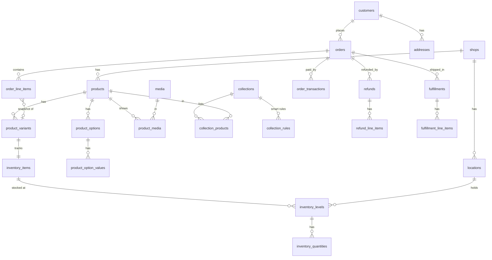

# Data model (PostgreSQL)

Status: proposal. The MVP implementation in `packages/core` simplifies this to a single store per installation (see
[../dev/foundation.md](../dev/foundation.md), "Deviations"). This is **our own design**, not a description of any vendor's storage. It is shaped by what the
Admin API subset in [admin-api-mvp.md](admin-api-mvp.md) must return and by what Liquid themes read
([liquid-compat.md](liquid-compat.md)). Names of API objects appear only to show which table backs them.

Scope: the tables needed to serve the MVP object set (Shop, Product, ProductOption, ProductVariant, InventoryItem,
InventoryLevel, Location, Collection, Customer, Order, LineItem, Fulfillment, Refund, OrderTransaction, Metafield) plus the
small amount of storefront content and theme storage required to render a theme. Carts/checkout, discounts, payments
adapters, webhooks and apps get their own specs; hooks for them are noted at the end.

## 1. Principles

1. **Multi-tenant by `shop_id`.** Every tenant-owned table has `shop_id bigint not null` and row-level security (section 2).
2. **Integer ids internally, GIDs at the edge.** Each table has `id bigint` from a sequence. The API formats it as
   `gid://shopify/<Type>/<id>` and as the string `legacyResourceId` (section 3). No UUIDs in URLs or API.
3. **Same-tenant foreign keys.** Parent tables carry `unique (shop_id, id)`; child tables reference `(shop_id, parent_id)`.
   This makes cross-tenant references impossible even if application code is wrong.
4. **Money is `numeric(19,4)`** plus a currency code. Rendering (two decimals for the `Money` scalar, trimmed zeros for
   `Decimal`) is done in the API layer using the currency's minor-unit exponent. Order tables keep both the shop-currency
   and the presentment-currency amount (the API's "money bag" pairs).
5. **Enums as `text` + `check`** (not native enums), because API enums gain values between versions.
6. **Timestamps are `timestamptz`**, serialised as UTC with second precision. `created_at`/`updated_at` on all mutable tables;
   `updated_at` maintained by trigger.
7. **Arrays for small value lists** (`tags text[]`, with a GIN index), child tables for anything with identity or ordering.
8. **Keyset pagination.** Every connection sort key needs an index ending in `id` so cursors can be `(sort_value, id)`.
9. **Hard delete + tombstones.** Deleting a resource removes rows; a `deleted_resources` log (id, type, deleted_at) feeds webhooks
   and sync clients.
10. **No JSON blobs for first-class fields** (jsonb only for snapshots such as order addresses and for free-form settings).

## 2. Multi-tenancy and row-level security

- Roles: `shopme_owner` (owns objects, runs migrations, not used at runtime), `shopme_app` (runtime role; **no** `BYPASSRLS`,
  not table owner), `shopme_ops` (`BYPASSRLS`, used only by cross-tenant jobs such as billing or tenant provisioning).
- Per request/job: open a transaction and run `select set_config('app.shop_id', '<id>', true)` (transaction-local, safe under
  connection pooling in transaction mode). A helper `app_shop_id()` returns `current_setting('app.shop_id', true)::bigint`.
- For each tenant table:

```sql
alter table products enable row level security;
alter table products force row level security;
create policy tenant_isolation on products
  using (shop_id = app_shop_id())
  with check (shop_id = app_shop_id());
```

- `shops` is guarded by `id = app_shop_id()`. Global reference tables (`currencies`, `countries`, `fonts`) have no `shop_id`.
- **Token lookup happens before the tenant is known.** Keep `access_tokens` readable through a `security definer` function
  `resolve_access_token(hash bytea)` that returns `(shop_id, app_id, scopes, expires_at)`, instead of exempting the table.
- Tests must include a "forgot to set `app.shop_id`" case (must return zero rows / fail) and a cross-tenant FK attempt.

## 3. Id allocation and GID mapping

- One sequence per table: `create sequence products_id_seq start 1000000000000 ...` (large starting values make ids look like
  the 11-14 digit numbers clients are used to, and keep them inside the JS-safe-integer range for tools that parse ids as
  numbers). Ids are unique per table across all tenants.
- `GID = 'gid://shopify/' || TypeName || '/' || id`. Resolution (`node(id:)`): parse, look up `TypeName` in a static map to a table,
  `select ... where id = $1` under RLS (so another tenant's id simply returns null).
- `legacyResourceId` is `id::text`.

| API type (GID type name) | Table | Notes |
|---|---|---|
| `Shop` | `shops` | |
| `Product` | `products` | |
| `ProductOption` | `product_options` | |
| `ProductOptionValue` | `product_option_values` | |
| `ProductVariant` | `product_variants` | |
| `InventoryItem` | `inventory_items` | 1:1 with a variant, own id |
| `InventoryLevel` | `inventory_levels` | public docs describe a composite id form carrying the item id as a query-style suffix; verify against our store before choosing the format |
| `Location` | `locations` | |
| `Collection` | `collections` | |
| `Customer` | `customers` | |
| `MailingAddress` | `addresses` | customer addresses; order addresses are snapshots without ids |
| `Order` | `orders` | |
| `LineItem` | `order_line_items` | |
| `OrderTransaction` | `order_transactions` | |
| `Fulfillment` | `fulfillments` | |
| `FulfillmentOrder` | `fulfillment_orders` | minimal, see section 7 |
| `Refund` / `RefundLineItem` | `refunds` / `refund_line_items` | |
| `MediaImage` (and other media) | `media` | type column selects the GID type name |
| `Metafield` | `metafields` | |
| `Job` | `jobs` | |

## 4. Entity overview



## 5. Tables

Conventions in the DDL sketches: every table below also has `shop_id bigint not null`, `created_at`, `updated_at` unless stated;
the primary key is `id`; each has `unique (shop_id, id)` for composite foreign keys (abbreviated to `-> products` in comments).
Types are PostgreSQL. This is a sketch for review, not a migration.

### 5.1 Shop, domains, access

```sql
create table shops (
  id bigint primary key,
  myshopify_domain text not null unique,          -- Shop.myshopifyDomain
  name text not null,
  email text not null,                            -- account email
  contact_email text not null,
  description text,
  currency_code char(3) not null,                 -- Shop.currencyCode
  enabled_presentment_currencies char(3)[] not null default '{}',
  iana_timezone text not null,
  weight_unit text not null check (weight_unit in ('KILOGRAMS','GRAMS','POUNDS','OUNCES')),
  unit_system text not null check (unit_system in ('IMPERIAL_SYSTEM','METRIC_SYSTEM')),
  taxes_included boolean not null default false,
  tax_shipping boolean not null default false,
  money_format text not null,                     -- template with an {{amount}} placeholder
  money_with_currency_format text not null,
  money_in_emails_format text, money_with_currency_in_emails_format text,
  address jsonb not null default '{}',            -- ShopAddress (address1, city, countryCode, ...)
  features jsonb not null default '{"storefront":true,"giftCards":false}',
  password_enabled boolean not null default false, password_hash text,
  order_number_prefix text not null default '#', order_number_suffix text not null default '',
  next_order_number integer not null default 1001,
  created_at timestamptz not null default now(), updated_at timestamptz not null default now()
);

create table shop_domains (
  id bigint primary key, shop_id bigint not null references shops(id),
  host text not null unique, is_primary boolean not null default false, ssl_enabled boolean not null default true
);  -- exactly one primary per shop (partial unique index on shop_id where is_primary)

create table apps (            -- client credentials registered for a shop
  id bigint primary key, shop_id bigint not null references shops(id),
  client_id text not null unique, client_secret_hash bytea not null,
  scopes text[] not null default '{}'
);
create table access_tokens (   -- issued by the client-credentials grant; ~24 h lifetime
  id bigint primary key, shop_id bigint not null, app_id bigint not null references apps(id),
  token_hash bytea not null unique, scopes text[] not null, expires_at timestamptz not null, revoked_at timestamptz
);
```

Rate-limit buckets live in Redis (per token), not in Postgres.

### 5.2 Locations and inventory

```sql
create table locations (
  id bigint primary key, shop_id bigint not null,
  name text not null, is_active boolean not null default true,
  fulfills_online_orders boolean not null default true,
  is_fulfillment_service boolean not null default false,
  address1 text, address2 text, city text, province_code text, zip text, country_code char(2), phone text,
  unique (shop_id, id)
);

create table inventory_items (
  id bigint primary key, shop_id bigint not null,
  variant_id bigint not null,                     -- -> product_variants (unique: 1:1)
  sku text, tracked boolean not null default true, requires_shipping boolean not null default true,
  weight_value numeric(12,4), weight_unit text check (weight_unit in ('KILOGRAMS','GRAMS','POUNDS','OUNCES')),
  country_code_of_origin char(2), province_code_of_origin text, harmonized_system_code text,
  unit_cost numeric(19,4), unit_cost_currency char(3),
  unique (shop_id, id), unique (shop_id, variant_id)
);

create table inventory_levels (
  id bigint primary key, shop_id bigint not null,
  inventory_item_id bigint not null, location_id bigint not null,      -- composite FKs
  is_active boolean not null default true,
  unique (shop_id, id), unique (shop_id, inventory_item_id, location_id)
);

create table inventory_quantities (               -- one row per (level, quantity name)
  shop_id bigint not null, inventory_level_id bigint not null,
  name text not null check (name in ('available','on_hand','committed','incoming','reserved')),
  quantity integer not null default 0,            -- may be negative (oversell)
  updated_at timestamptz not null default now(),
  primary key (inventory_level_id, name)
);

create table inventory_adjustments (              -- append-only ledger; one row per changed quantity
  id bigint primary key, shop_id bigint not null,
  group_id bigint not null,                       -- one API call = one group (InventoryAdjustmentGroup)
  inventory_item_id bigint not null, location_id bigint not null,
  name text not null, delta integer not null, quantity_after integer not null,
  reason text not null, reference_document_uri text, app_id bigint, created_at timestamptz not null default now()
);
```

Rules: `on_hand` is stored, not derived; `available + committed` should equal `on_hand` in the observed data, enforced in
the service layer (not a check constraint, because other quantity names can be introduced). A variant's `inventoryQuantity`
is `sum(available)` over its active levels; compute in SQL (indexed by `inventory_item_id`) and optionally cache in
`product_variants.inventory_quantity_cached` maintained in the same transaction. `Product.totalInventory` sums variants.
Writes to quantities always go through `inventory_adjustments` in one transaction (lock the level row `for update`;
support the optional `changeFromQuantity` compare-and-set).

### 5.3 Products

```sql
create table products (
  id bigint primary key, shop_id bigint not null,
  handle text not null, title text not null, description_html text not null default '',
  status text not null default 'DRAFT' check (status in ('ACTIVE','ARCHIVED','DRAFT','UNLISTED')),
  vendor text not null default '', product_type text not null default '',
  tags text[] not null default '{}',
  template_suffix text, gift_card_template_suffix text,
  seo_title text, seo_description text,
  published_at timestamptz,                       -- null = not on the online storefront
  is_gift_card boolean not null default false, requires_selling_plan boolean not null default false,
  featured_media_id bigint,
  search_vector tsvector,                         -- title, vendor, type, tags, sku (maintained by trigger)
  unique (shop_id, id), unique (shop_id, handle)
);
create index on products using gin (tags);
create index on products using gin (search_vector);
create index on products (shop_id, status, updated_at desc, id);
create index on products (shop_id, vendor, id);  create index on products (shop_id, product_type, id);

create table product_options (
  id bigint primary key, shop_id bigint not null, product_id bigint not null,
  name text not null, position integer not null, unique (shop_id, id), unique (product_id, position), unique (product_id, name)
);
create table product_option_values (
  id bigint primary key, shop_id bigint not null, option_id bigint not null,
  name text not null, position integer not null, swatch_color text, swatch_media_id bigint,
  unique (shop_id, id), unique (option_id, name)
);  -- ProductOptionValue.hasVariants = exists(select 1 from variant_option_values ...)

create table product_variants (
  id bigint primary key, shop_id bigint not null, product_id bigint not null,
  position integer not null, title text not null,          -- joined option values, or 'Default Title'
  sku text, barcode text,
  price numeric(19,4) not null, compare_at_price numeric(19,4),
  taxable boolean not null default true, tax_code text,
  inventory_policy text not null default 'DENY' check (inventory_policy in ('DENY','CONTINUE')),
  media_id bigint,
  unique (shop_id, id), unique (product_id, position)
);
create index on product_variants (shop_id, sku);   create index on product_variants (shop_id, product_id, position);

create table variant_option_values (               -- ProductVariant.selectedOptions
  shop_id bigint not null, variant_id bigint not null, option_id bigint not null, option_value_id bigint not null,
  primary key (variant_id, option_id)
);

create table media (                               -- images, video, external video, 3D
  id bigint primary key, shop_id bigint not null,
  type text not null check (type in ('IMAGE','VIDEO','EXTERNAL_VIDEO','MODEL_3D')),
  alt text, status text not null default 'READY',
  storage_key text,                                -- object storage key of the original
  external_url text, mime_type text, width integer, height integer, byte_size bigint,
  unique (shop_id, id)
);
create table product_media (
  shop_id bigint not null, product_id bigint not null, media_id bigint not null, position integer not null,
  primary key (product_id, media_id), unique (product_id, position)
);
```

Notes: `Product.featuredMedia` = first `product_media` row or `featured_media_id` when explicitly set. Product price
range and `hasOnlyDefaultVariant`/`hasOutOfStockVariants` are computed from variants (cache columns are allowed later).
`publishedAt` stands in for "published to the online store" until a publications model exists. Selling plans are not modelled.

### 5.4 Collections

```sql
create table collections (
  id bigint primary key, shop_id bigint not null,
  handle text not null, title text not null, description_html text not null default '',
  sort_order text not null default 'MANUAL' check (sort_order in
     ('ALPHA_ASC','ALPHA_DESC','BEST_SELLING','MOST_RELEVANT','CREATED','CREATED_DESC','MANUAL','PRICE_ASC','PRICE_DESC')),
  template_suffix text, seo_title text, seo_description text, image_media_id bigint,
  is_smart boolean not null default false, rules_applied_disjunctively boolean not null default false,
  published_at timestamptz, members_refreshed_at timestamptz,
  unique (shop_id, id), unique (shop_id, handle)
);
create table collection_rules (                    -- present only for smart collections
  id bigint primary key, shop_id bigint not null, collection_id bigint not null, position integer not null,
  rule_column text not null,                       -- CollectionRuleColumn
  relation text not null,                          -- CollectionRuleRelation
  condition text not null, condition_object_id bigint
);
create table collection_products (                 -- manual picks and materialised smart membership
  shop_id bigint not null, collection_id bigint not null, product_id bigint not null,
  position integer not null default 0,             -- manual order (sort_order = MANUAL)
  source text not null default 'manual' check (source in ('manual','rule')),
  primary key (collection_id, product_id)
);
create index on collection_products (shop_id, product_id);
create index on collection_products (collection_id, position);
```

Smart collections: the worker re-evaluates membership when a product, variant or inventory row changes (debounced job
per shop) and rewrites rows with `source = 'rule'`. Rule-to-SQL mapping: TAG -> `tags` array membership; TITLE/VENDOR/TYPE ->
text comparison on `products`; VARIANT_PRICE / VARIANT_COMPARE_AT_PRICE / VARIANT_WEIGHT / VARIANT_INVENTORY /
VARIANT_TITLE -> `exists` over variants (a product matches when **any** variant satisfies the condition, to be confirmed);
IS_PRICE_REDUCED -> `compare_at_price > price`. `Collection.productsCount` = count of `collection_products` rows
(only products visible to the viewer for storefront queries). `Collection.products` ordering follows `sort_order`
(manual -> `position`; others via the product columns; best-selling needs an order-aggregate rollup, later).

### 5.5 Customers

```sql
create table customers (
  id bigint primary key, shop_id bigint not null,
  first_name text, last_name text, email citext, phone text, locale text not null default 'en',
  note text, tags text[] not null default '{}',
  state text not null default 'DISABLED' check (state in ('DECLINED','DISABLED','ENABLED','INVITED')),
  verified_email boolean not null default false, tax_exempt boolean not null default false,
  email_marketing_state text not null default 'NOT_SUBSCRIBED',
  email_marketing_opt_in_level text, email_marketing_updated_at timestamptz,
  sms_marketing_state text, sms_marketing_updated_at timestamptz,
  default_address_id bigint,
  number_of_orders integer not null default 0, amount_spent numeric(19,4) not null default 0,   -- denormalised
  amount_spent_currency char(3),
  password_hash text, last_login_at timestamptz,   -- storefront accounts (state = ENABLED)
  unique (shop_id, id)
);
create unique index on customers (shop_id, email) where email is not null;
create unique index on customers (shop_id, phone) where phone is not null;
create index on customers using gin (tags);

create table addresses (
  id bigint primary key, shop_id bigint not null, customer_id bigint not null,
  first_name text, last_name text, company text, address1 text, address2 text, city text,
  province text, province_code text, zip text, country text, country_code char(2), phone text,
  unique (shop_id, id)
);
```

`displayName` is derived (name parts, else email, else phone). Merge/dedupe, consent history and account-invite tokens are
later additions.

### 5.6 Orders

```sql
create table orders (
  id bigint primary key, shop_id bigint not null,
  order_number integer not null, name text not null,                        -- '#1001'
  customer_id bigint, email text, phone text,
  currency_code char(3) not null, presentment_currency_code char(3) not null,
  taxes_included boolean not null, test boolean not null default false, confirmed boolean not null default true,
  financial_status text, fulfillment_status text not null default 'UNFULFILLED',   -- OrderDisplay* values
  cancel_reason text, cancelled_at timestamptz, closed_at timestamptz, processed_at timestamptz not null default now(),
  note text, tags text[] not null default '{}', source_name text,
  shipping_address jsonb, billing_address jsonb,           -- snapshots (no ids)
  subtotal_shop numeric(19,4), subtotal_pres numeric(19,4),
  total_shop numeric(19,4) not null, total_pres numeric(19,4) not null,
  total_tax_shop numeric(19,4), total_tax_pres numeric(19,4),
  total_shipping_shop numeric(19,4) not null default 0, total_shipping_pres numeric(19,4) not null default 0,
  total_discounts_shop numeric(19,4), total_discounts_pres numeric(19,4),
  total_refunded_shop numeric(19,4) not null default 0, total_refunded_pres numeric(19,4) not null default 0,
  unique (shop_id, id), unique (shop_id, order_number)
);
create index on orders (shop_id, created_at desc, id);  create index on orders (shop_id, customer_id, created_at desc);
create index on orders (shop_id, financial_status);     create index on orders (shop_id, fulfillment_status);

create table order_line_items (
  id bigint primary key, shop_id bigint not null, order_id bigint not null, position integer not null,
  product_id bigint, variant_id bigint,                      -- nullable: kept as plain ids so deletes do not cascade
  name text not null, title text not null, variant_title text, sku text, vendor text,
  quantity integer not null, current_quantity integer not null,
  requires_shipping boolean not null, taxable boolean not null, is_gift_card boolean not null default false,
  original_unit_price_shop numeric(19,4) not null, original_unit_price_pres numeric(19,4) not null,
  discounted_total_shop numeric(19,4) not null, discounted_total_pres numeric(19,4) not null,
  properties jsonb not null default '[]',
  unique (shop_id, id)
);
create table order_tax_lines (
  id bigint primary key, shop_id bigint not null, order_id bigint not null,
  line_item_id bigint, shipping_line_id bigint,
  title text not null, rate numeric(9,6) not null, price_shop numeric(19,4) not null, price_pres numeric(19,4) not null
);
create table order_shipping_lines (
  id bigint primary key, shop_id bigint not null, order_id bigint not null,
  title text not null, code text, price_shop numeric(19,4) not null, price_pres numeric(19,4) not null
);
create table order_transactions (
  id bigint primary key, shop_id bigint not null, order_id bigint not null, parent_transaction_id bigint,
  kind text not null check (kind in ('SALE','CAPTURE','AUTHORIZATION','VOID','REFUND','CHANGE','EMV_AUTHORIZATION','SUGGESTED_REFUND')),
  status text not null check (status in ('SUCCESS','FAILURE','PENDING','ERROR','AWAITING_RESPONSE','UNKNOWN')),
  gateway text, amount_shop numeric(19,4) not null, amount_pres numeric(19,4) not null,
  test boolean not null default false, error_code text, payment_id text, processed_at timestamptz,
  unique (shop_id, id)
);
```

Line items copy title, SKU, vendor and prices at purchase time (history must survive product edits); `variant_id` /
`product_id` are plain nullable columns, with no foreign key, matching the API's nullable `variant`/`product`.
Order numbering: allocate from `shops.next_order_number` with `update ... returning` in the order transaction.
`displayFinancialStatus` is derived from transactions/refunds and stored for filtering (updated by the service layer in the same transaction);
`displayFulfillmentStatus` likewise from fulfillments. Discount applications are modelled later (`order_discounts`); until
then the API returns empty connections.

### 5.7 Fulfillment and refunds

```sql
create table fulfillment_orders (                  -- minimal: groups unfulfilled line items by location
  id bigint primary key, shop_id bigint not null, order_id bigint not null, location_id bigint,
  status text not null default 'OPEN', unique (shop_id, id)
);
create table fulfillment_order_line_items (
  id bigint primary key, shop_id bigint not null, fulfillment_order_id bigint not null,
  line_item_id bigint not null, total_quantity integer not null, fulfilled_quantity integer not null default 0
);
create table fulfillments (
  id bigint primary key, shop_id bigint not null, order_id bigint not null, fulfillment_order_id bigint,
  location_id bigint, name text not null,                   -- '#1001.1'
  status text not null check (status in ('SUCCESS','CANCELLED','ERROR','FAILURE')),
  display_status text, tracking_company text, tracking_numbers text[] not null default '{}', tracking_urls text[] not null default '{}',
  notify_customer boolean not null default false, delivered_at timestamptz, unique (shop_id, id)
);
create table fulfillment_line_items (
  id bigint primary key, shop_id bigint not null, fulfillment_id bigint not null, line_item_id bigint not null, quantity integer not null
);
create table refunds (
  id bigint primary key, shop_id bigint not null, order_id bigint not null, note text,
  total_refunded_shop numeric(19,4) not null, total_refunded_pres numeric(19,4) not null,
  processed_at timestamptz not null default now(), unique (shop_id, id)
);
create table refund_line_items (
  id bigint primary key, shop_id bigint not null, refund_id bigint not null, line_item_id bigint not null,
  quantity integer not null, restock_type text, location_id bigint,
  subtotal_shop numeric(19,4), subtotal_pres numeric(19,4), total_tax_shop numeric(19,4), total_tax_pres numeric(19,4)
);
```

`Fulfillment` creation takes line items grouped by fulfillment order, so order creation also creates one fulfillment order
per shipping location containing the shippable lines. Refund transactions are rows in `order_transactions` (`kind = 'REFUND'`)
linked by `refund_id` (add nullable column), and restocking (`restock_type`) posts to `inventory_adjustments`.

### 5.8 Metafields and tags

```sql
create table metafields (
  id bigint primary key, shop_id bigint not null,
  owner_type text not null,                        -- PRODUCT, PRODUCTVARIANT, COLLECTION, CUSTOMER, ORDER, LOCATION, SHOP ...
  owner_id bigint not null,                        -- polymorphic: no FK, cleaned up by delete triggers / jobs
  namespace text not null, key text not null,
  type text not null,                              -- e.g. single_line_text_field
  value text not null, definition_id bigint,
  unique (shop_id, owner_type, owner_id, namespace, key)
);
create index on metafields (shop_id, owner_type, owner_id);
```

Namespace/key length limits and type-specific validation of `value` live in the service layer. Metafield definitions
(`metafield_definitions`) and typed reference values are a later addition. Distinct tag lists for the `productTags`-style
roots come from `select distinct unnest(tags)`; promote to a table only if it becomes slow.

### 5.9 Storefront content and theme storage (needed to render themes)

```sql
create table themes (
  id bigint primary key, shop_id bigint not null, name text not null,
  role text not null check (role in ('MAIN','UNPUBLISHED','DEMO','DEVELOPMENT')),
  processing boolean not null default false, unique (shop_id, id)
);
create table theme_files (                           -- templates, sections, blocks, snippets, config, locales, assets
  theme_id bigint not null, shop_id bigint not null,
  path text not null,                                -- 'sections/header.liquid', 'assets/base.css'
  content_type text not null, checksum text not null, size_bytes integer not null,
  body text,                                         -- text files (liquid, json, css, js, svg)
  storage_key text,                                  -- binary files in object storage
  updated_at timestamptz not null default now(),
  primary key (theme_id, path)
);
create table pages (id bigint primary key, shop_id bigint not null, handle text not null, title text not null,
  body_html text not null default '', template_suffix text, published_at timestamptz, unique (shop_id, handle));
create table blogs (id bigint primary key, shop_id bigint not null, handle text not null, title text not null,
  template_suffix text, comment_policy text, unique (shop_id, handle));
create table articles (id bigint primary key, shop_id bigint not null, blog_id bigint not null, handle text not null,
  title text not null, author text, body_html text, summary_html text, tags text[] not null default '{}',
  image_media_id bigint, template_suffix text, published_at timestamptz, unique (blog_id, handle));
create table menus (id bigint primary key, shop_id bigint not null, handle text not null, title text not null, unique (shop_id, handle));
create table menu_items (id bigint primary key, shop_id bigint not null, menu_id bigint not null,
  parent_id bigint, position integer not null, title text not null,
  link_type text not null, resource_id bigint, url text);        -- link_type: PRODUCT, COLLECTION, PAGE, HTTP, ...
create table url_redirects (id bigint primary key, shop_id bigint not null, path text not null, target text not null, unique (shop_id, path));
```

The theme loader reads `theme_files` (cache parsed schemas per `checksum`). `config/settings_data.json` is just another file;
the editor-style "current settings" are read from it and not duplicated in a table. Setting values of type
page/blog/collection/product/link_list refer to handles, resolved against these tables.

### 5.10 Async jobs and events

```sql
create table jobs (id bigint primary key, shop_id bigint not null, type text not null,
  status text not null default 'PENDING', done boolean not null default false, result jsonb, error text, created_at timestamptz default now(), finished_at timestamptz);
create table deleted_resources (shop_id bigint not null, resource_type text not null, resource_id bigint not null, deleted_at timestamptz default now());
create table outbox_events (id bigint primary key, shop_id bigint not null, topic text not null, resource_id bigint, payload jsonb not null,
  created_at timestamptz default now(), published_at timestamptz);
```

`jobs` back the API's `Job` / `*Operation` objects (execution runs in BullMQ; the row is the durable status). The
transactional outbox feeds webhooks (separate spec) and search/membership refresh.

## 6. API field to storage mapping (highlights)

| API field | Storage |
|---|---|
| `Shop.currencyFormats.moneyFormat` | `shops.money_format` |
| `Shop.primaryDomain` | `shop_domains where is_primary` |
| `Product.priceRangeV2` | `min/max(product_variants.price)` + `shops.currency_code` |
| `Product.options[].optionValues[].hasVariants` | exists in `variant_option_values` |
| `ProductVariant.selectedOptions` | `variant_option_values` join `product_options`/`product_option_values`, ordered by option position |
| `ProductVariant.inventoryQuantity` | sum of `inventory_quantities` where `name='available'` over active levels (the API field is nullable; record when the platform returns null) |
| `ProductVariant.availableForSale` | `tracked = false` or `inventory_policy = 'CONTINUE'` or `inventoryQuantity > 0` (matches observed rows) |
| `InventoryItem.measurement.weight` | `inventory_items.weight_value`, `weight_unit` |
| `InventoryLevel.quantities(names:)` | rows of `inventory_quantities` filtered by name |
| `Collection.ruleSet` | `collections.is_smart`, `rules_applied_disjunctively`, `collection_rules` |
| `Customer.defaultEmailAddress` | `customers.email`, `email_marketing_state` |
| `Customer.numberOfOrders`, `amountSpent` | denormalised columns, updated with order writes |
| `Order.totalPriceSet` | `total_shop` / `total_pres` + currency columns -> `MoneyBag` |
| `Order.transactions` | `order_transactions` ordered by id |
| `Metafield.value` | `metafields.value` (always text) |

## 7. Decisions and open questions

- `FulfillmentOrder`: smallest model that lets `fulfillmentCreate` work; richer behavior (holds, requests, moves) later.
- Publication to sales channels is reduced to `published_at`; a `publications` table can be introduced without changing ids.
- Whether a smart collection matches a product when *any* or *all* variants satisfy variant-level rules must be checked
  on our dev store and then encoded in a conformance test.
- `inventoryQuantity` semantics for untracked items (observed 0 but sellable) should be reproduced exactly.
- Search (`query:` argument): start with SQL predicates and the `search_vector` column; consider an external index only if needed.
- Carts/checkouts (`carts`, `cart_lines`, `checkouts`), discounts, payments (`payment_intents`, provider references),
  webhooks (`webhook_subscriptions`, `webhook_deliveries`), apps and OAuth grants are intentionally absent; each will follow the same
  rules (`shop_id`, RLS, composite FKs, GID mapping).
